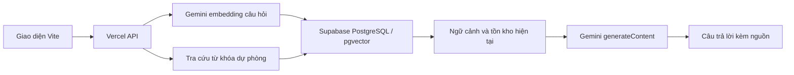

# Thư Viện AI

Chatbot thư viện đơn giản để đưa vào CV: tra cứu tồn kho, nội dung cơ bản của sách và giờ hành chính bằng dữ liệu nội bộ. Giao diện tiếng Việt, backend serverless cùng chạy trên Vercel. PostgreSQL trên Supabase, không dùng ChromaDB hay LangChain.

**Demo:** https://chatbot-library-jet.vercel.app

## Chức năng

- Hỏi đáp có nguồn tham khảo; tìm sách có dấu hoặc không dấu.
- Danh mục: tổng số, số còn, vị trí kệ, tóm tắt, thời điểm cập nhật.
- Giờ hành chính, nội quy và thông báo lấy từ tài liệu nội bộ.
- Quản trị có mật khẩu: thêm/sửa sách, cập nhật tồn kho và tài liệu; lập lại chỉ mục khi lưu.
- Không có dữ liệu thì báo chưa biết; không giả lập đặt sách hoặc mượn sách.
- Giới hạn PostgreSQL: 15 câu hỏi/10 phút/IP; quản trị 40 yêu cầu/10 phút/IP.

## Kiến trúc RAG



Mỗi sách/tài liệu ngắn là một đoạn; tạo embedding 768 chiều với `gemini-embedding-001`, lưu vào `library_chunks.embedding`. RPC `library_match` tìm cosine similarity. Backend kết hợp vector và từ khóa, lấy tối đa 5 nguồn rồi đưa vào ngữ cảnh Gemini. Tồn kho được đọc lại từ bảng sách hiện tại để tránh dùng số cũ trong embedding.

RAG giúp trả lời **dữ liệu riêng đã nhập vào hệ thống**, chẳng hạn số cuốn tại kệ A2 hoặc lịch nội bộ. Mô hình không thể biết thông tin chưa được cung cấp.

Khi Gemini không hoạt động/hết quota, ứng dụng trả kết quả tra cứu từ khóa và ghi rõ chế độ dự phòng. Đây không phải câu trả lời sinh bởi AI. Chưa có embedding thì vector search chưa hoạt động; không tạo embedding giả.

## Chạy local

Yêu cầu Node.js 22.12+ và Vercel CLI. Deployment dùng Node 24.

```bash
npm install
cp .env.example .env
# Điền biến môi trường trong .env
# Chạy supabase/schema.sql bằng SQL Editor hoặc Supabase Management API
npm run index
npm run dev
```

Trên PowerShell thay `cp` bằng `Copy-Item` nếu cần. `npm run dev` chạy giao diện và API qua `vercel dev`. `npm run dev:ui` chỉ phục vụ giao diện, không có API. Khi Vercel CLI hỏi môi trường local, dùng các giá trị trong `.env`.

| Biến môi trường             | Mục đích                                                              |
| --------------------------- | --------------------------------------------------------------------- |
| `SUPABASE_URL`              | URL project Supabase                                                  |
| `SUPABASE_SERVICE_ROLE_KEY` | Khóa server, không đưa vào frontend                                   |
| `GEMINI_API_KEY`            | Khóa Google AI Studio của project đang hoạt động                      |
| `GEMINI_MODEL`              | Mặc định `gemini-2.5-flash`, có thể đổi theo model tài khoản có quota |
| `ADMIN_PASSWORD`            | Mật khẩu quản trị dài, ngẫu nhiên                                     |
| `RATE_LIMIT_SALT`           | Chuỗi ngẫu nhiên để băm IP trước khi lưu bộ đếm                       |

Không đặt tiền tố `VITE_` cho khóa. `.env`, `.env.local` và `.vercel` được Git bỏ qua. Token Supabase Management chỉ dùng thiết lập, không cần cho ứng dụng khi chạy.

## Dữ liệu và quản trị

Schema tạo `library_books`, `library_documents`, `library_chunks`, `library_rate_limits`, bật RLS và không có policy công khai. Backend dùng service role; RPC chỉ cho service role gọi. Schema chạy lại được, chỉ seed mẫu khi bảng trống.

Mở **Quản trị dữ liệu**, nhập `ADMIN_PASSWORD` trong `.env` trên máy. Mật khẩu chỉ giữ trong bộ nhớ trang, không lưu localStorage. Sửa 6 sách và 3 tài liệu mẫu để thay bằng dữ liệu thực tế. Lịch mẫu không phải thông tin chính thức của UTH. Hệ thống quản lý số tồn tổng hợp; chưa quản lý bạn đọc, giao dịch mượn/trả hoặc từng bản sách.

Sau khi thay khóa Gemini hoặc sửa dữ liệu bằng SQL trực tiếp:

```bash
npm run index
```

Đầu ra `lexical` nghĩa là chưa tạo embedding; đầu ra `vector` nghĩa là đã có embedding thật. Dữ liệu mẫu nhỏ nên tìm vector chính xác trong PostgreSQL là đủ, chưa cần HNSW. Quota miễn phí phụ thuộc tài khoản và model.

## Kiểm thử

```bash
npm test
npm run build
node --env-file=.env scripts/smoke.mjs
```

Smoke test cần Supabase đã seed mẫu; kiểm tra tồn kho, giờ hành chính, tên sách chưa có, xác thực quản trị và chặn tồn kho không hợp lệ. Nếu thay dữ liệu mẫu cần cập nhật kỳ vọng trong script.

## Deploy Vercel

Import repository, chọn Vite, build `npm run build`, output `dist`. Khai báo 6 biến môi trường Production rồi deploy. `api/` trở thành Node.js serverless functions cùng domain.

```bash
vercel link
# Thêm từng biến: vercel env add TEN_BIEN production
vercel --prod
```

GitHub đã liên kết với Vercel. Sau khi thay biến môi trường Production, redeploy để áp dụng.

API: `GET /api/catalog`, `POST /api/chat` với `{ "message": "..." }`, `GET/POST /api/admin` với header `Authorization: Bearer <ADMIN_PASSWORD>`. Chat xử lý từng câu độc lập, không lưu hội thoại phía server; nhắc lại tên sách trong câu tiếp theo.

## Trạng thái ngày 01/11/2026

Supabase đã có dữ liệu và chỉ mục từ khóa. Khóa Gemini được cung cấp trả `403 CONSUMER_SUSPENDED`: Google báo project chứa khóa bị đình chỉ. Chưa kiểm chứng được câu trả lời AI hoặc embeddings thật. Cần khóa của project hoạt động, chạy lại `npm run index`, cập nhật biến môi trường Vercel rồi redeploy. Không có khóa hoặc token thật trong repository.

Tài liệu: [Gemini embeddings](https://ai.google.dev/gemini-api/docs/embeddings), [Supabase pgvector](https://supabase.com/docs/guides/database/extensions/pgvector), [Vercel Functions](https://vercel.com/docs/functions).
