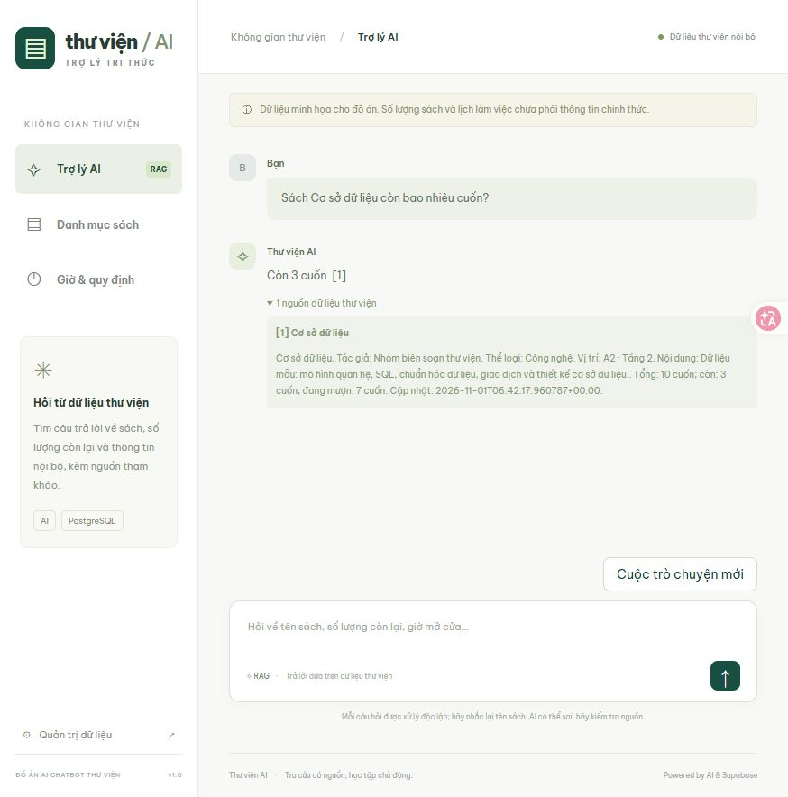
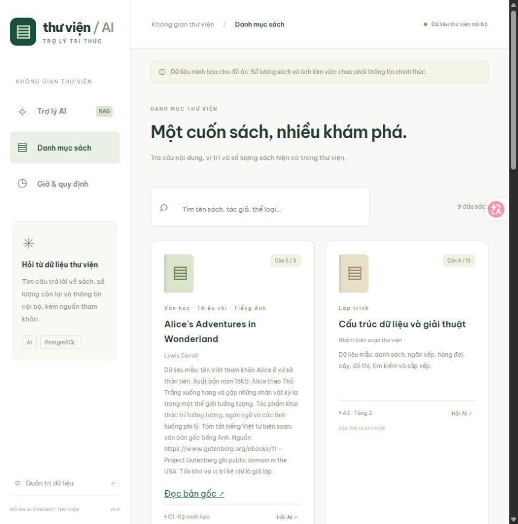
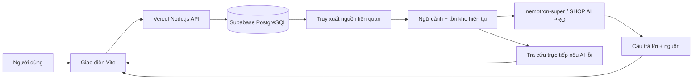

<div align="center">


# Thư Viện AI

**Trợ lý thư viện tiếng Việt — tìm sách, tra cứu tồn kho, trả lời kèm nguồn.**

Một đồ án ứng dụng AI vào dữ liệu thư viện, từ giao diện người dùng đến quản trị và triển khai serverless.

[](https://chatbot-library-jet.vercel.app)
[](https://nodejs.org/)
[](https://vite.dev/)
[](https://supabase.com/)
[](#kết-nối-ai)
[](#quyền-sử-dụng)

[**Trải nghiệm demo ↗**](https://chatbot-library-jet.vercel.app) · [Ảnh demo](#ảnh-demo) · [Tính năng](#tính-năng) · [Chạy local](#chạy-local) · [Triển khai](#triển-khai) · [API](docs/API.md) · [Tài liệu](#tài-liệu)

</div>

---

## Giới thiệu

**Thư Viện AI** giúp người dùng hỏi thông tin bằng ngôn ngữ tự nhiên: cuốn sách còn bao nhiêu bản, nằm ở đâu, có nội dung gì và thư viện làm việc khi nào. Thay vì chỉ dựa vào kiến thức sẵn có của model, ứng dụng truy xuất danh mục sách và tài liệu đang lưu trong Supabase, đưa các nguồn liên quan vào ngữ cảnh rồi tạo câu trả lời tiếng Việt.

Mỗi câu trả lời có thể mở nguồn để đối chiếu. Khi không tìm thấy dữ liệu, hệ thống báo chưa có thông tin. Khi nhà cung cấp AI lỗi, chức năng tra cứu vẫn trả dữ liệu trực tiếp và ghi rõ chế độ dự phòng.

> **Về bản demo:** tồn kho, vị trí kệ, lịch làm việc và quy định đều là dữ liệu minh họa. Ba sách văn học có tên, tác giả và nguồn văn bản công cộng được dẫn rõ; ứng dụng không đại diện cho thư viện hay trường học nào.

## Ảnh demo

<table>
  <tr>
    <td width="50%" align="center"><strong>Chat và đối chiếu nguồn</strong></td>
    <td width="50%" align="center"><strong>Danh mục và tồn kho</strong></td>
  </tr>
  <tr>
    <td><a href="docs/assets/chat-demo.jpg"></a></td>
    <td><a href="docs/assets/catalog-demo.jpg"></a></td>
  </tr>
</table>

Ảnh chụp từ bản demo đã triển khai, ngày **05/11/2026**. Nhấn vào ảnh để xem kích thước đầy đủ.

## Tính năng

| Nhóm | Chức năng |
| --- | --- |
| **Hỏi đáp tiếng Việt** | Hỏi tên sách, nội dung, vị trí, số lượng còn, giờ hành chính và quy định |
| **Trả lời có nguồn** | Tối đa 5 nguồn liên quan; mở phần tham khảo để kiểm tra dữ liệu |
| **Tra cứu sách** | Tìm theo tên, tác giả, thể loại; hỗ trợ tiếng Việt có dấu và không dấu |
| **Danh mục trực quan** | Xem tổng số, số còn, trạng thái hết sách, vị trí kệ và thời điểm cập nhật |
| **Sách công cộng** | Mô tả tự biên soạn, liên kết tới bản gốc tiếng Anh trên Project Gutenberg |
| **Quản trị dữ liệu** | Xác thực mật khẩu; thêm/sửa sách, tồn kho, tài liệu; đăng xuất và hủy chỉnh sửa |
| **Dự phòng khi AI lỗi** | Hiển thị dữ liệu tra cứu trực tiếp, không giả vờ là câu trả lời AI |
| **Trải nghiệm sử dụng** | Trạng thái đang tải, thử lại khi lỗi, cuộc trò chuyện mới, giao diện thích ứng màn hình nhỏ |
| **Bảo vệ backend** | Key ở server, RLS Supabase, kiểm tra dữ liệu, giới hạn request bằng PostgreSQL |

**Có thể thử ngay:**

- “Sách Cơ sở dữ liệu còn bao nhiêu cuốn?”
- “Cho tôi thông tin sách The Adventures of Sherlock Holmes.”
- “Giờ hành chính thư viện là khi nào?”
- “Quy định mượn sách như thế nào?”
- “Thư viện có sách Harry Potter không?”

## Kiến trúc



**Luồng xử lý:** kiểm tra câu hỏi và rate limit → đọc sách/tài liệu hiện tại → chọn tối đa 5 nguồn → tạo câu trả lời → trả nguồn cùng kết quả. Không có nguồn phù hợp thì trả thông báo chưa có thông tin, không gọi model để đoán dữ liệu.

Demo dùng **truy xuất từ khóa đã chuẩn hóa tiếng Việt**. Code có nhánh vector tùy chọn với Gemini embedding và pgvector, nhưng cấu hình demo hiện đặt `EMBEDDING_PROVIDER=none`. Đây là ứng dụng truy xuất kết hợp sinh câu trả lời (RAG); không huấn luyện lại model, không tuyên bố đã nghiệm thu tìm kiếm ngữ nghĩa.

| Thành phần | Công nghệ |
| --- | --- |
| Frontend | JavaScript ES Modules, HTML, CSS, Vite 7 |
| Backend | Node.js, Vercel Functions |
| Cơ sở dữ liệu | Supabase PostgreSQL, RLS, RPC |
| Model chat | `nemotron-super` qua SHOP AI PRO Chat Completions |
| Vector tùy chọn | `gemini-embedding-001`, 768 chiều, pgvector |
| Kiểm thử | Node.js Test Runner, smoke test tích hợp |

## Chạy local

### 1. Chuẩn bị

- **Node.js 22.12+**, khuyến nghị Node.js 24, và npm.
- Project Supabase của bạn.
- Key SHOP AI PRO có quyền dùng `nemotron-super` nếu muốn sinh câu trả lời AI. Gemini không bắt buộc cho cấu hình demo.

```bash
git clone https://github.com/levantri10/ChatBot_Library.git
cd ChatBot_Library
npm ci
```

### 2. Cấu hình server

PowerShell:

```powershell
Copy-Item .env.example .env
```

macOS/Linux:

```bash
cp .env.example .env
```

Điền `.env` theo bảng sau. Repository không cung cấp key hoặc mật khẩu dùng chung.

| Biến | Cấu hình demo / mục đích |
| --- | --- |
| `SUPABASE_URL` | URL project Supabase |
| `SUPABASE_SERVICE_ROLE_KEY` | Khóa server Supabase |
| `CHAT_PROVIDER` | `shopaipro` |
| `SHOPAI_BASE_URL` | `https://shopaipro.tech/v1` |
| `LIBRARY_SHOPAI_API_KEY` | Key SHOP AI PRO riêng cho chatbot |
| `SHOPAI_MODEL` | `nemotron-super` |
| `EMBEDDING_PROVIDER` | `none` để truy xuất từ khóa |
| `ADMIN_PASSWORD` | Mật khẩu quản trị dài, ngẫu nhiên |
| `RATE_LIMIT_SALT` | Chuỗi ngẫu nhiên dùng băm IP cho rate limit |
| `GEMINI_API_KEY` | Tùy chọn, chỉ cần khi dùng Gemini chat/embedding |
| `GEMINI_MODEL` | Model chat Gemini; mặc định `gemini-2.5-flash` |

Script local nạp `.env`, rồi `.env.local` nếu có; cấu hình dự án ưu tiên hơn biến môi trường kế thừa. Nếu có `.env.local`, kiểm tra file này khi thay đổi key/model.

### 3. Khởi tạo dữ liệu

Trong Supabase **SQL Editor**, chạy [supabase/schema.sql](supabase/schema.sql), sau đó:

```bash
npm run demo:import
npm run index
```

Schema tạo bảng, RPC, RLS, 6 sách và 3 tài liệu mẫu khi bảng trống. Import bổ sung 3 sách văn học nếu chưa có theo tiêu đề, không ghi đè dữ liệu đã sửa. `npm run index` hiển thị `lexical` khi chưa tạo embedding, `vector` khi có embedding thật.

### 4. Khởi động

```bash
npm run dev
```

Mở **[http://127.0.0.1:3000](http://127.0.0.1:3000)**. Lệnh chạy cả giao diện và API, không cần Vercel CLI. Đăng nhập **Quản trị dữ liệu** bằng `ADMIN_PASSWORD` trong cấu hình của bạn.

<details>
<summary><strong>Tất cả lệnh phát triển</strong></summary>

| Lệnh | Công dụng |
| --- | --- |
| `npm run dev` | Giao diện + API local, cổng 3000 |
| `npm run dev:ui` | Chỉ giao diện Vite, không có API |
| `npm run dev:vercel` | Local qua Vercel CLI đã cài riêng |
| `npm run build` | Build frontend vào `dist/` |
| `npm test` | Kiểm thử tự động, không cần key thật |
| `npm run smoke` | Kiểm tra tích hợp với Supabase và cấu hình AI hiện tại |
| `npm run demo:import` | Thêm dữ liệu sách công cộng minh họa |
| `npm run index` | Lập lại chỉ mục từ dữ liệu hiện tại |

</details>

## Kết nối AI

```text
POST https://shopaipro.tech/v1/chat/completions
Authorization: Bearer <LIBRARY_SHOPAI_API_KEY>
Model: nemotron-super
```

Backend gửi `messages` gồm system/user và chỉ đọc `choices[0].message.content`; không hiển thị trường reasoning. Key riêng của ứng dụng tránh xung đột với `SHOPAI_API_KEY` từ các client khác.

- **Chat hiện tại:** SHOP AI PRO; lỗi/timeout/câu trả lời bị cắt sẽ chuyển sang tra cứu trực tiếp.
- **Chat Gemini tùy chọn:** đặt `CHAT_PROVIDER=gemini` và cung cấp key/model hoạt động.
- **Embedding tùy chọn:** đặt `EMBEDDING_PROVIDER=gemini`, cung cấp key rồi chạy `npm run index`. Xem [hướng dẫn vector](docs/DEPLOYMENT.md#embedding-vector-tùy-chọn).

Tài liệu nhà cung cấp: [SHOP AI PRO](https://shopaipro.tech/docs). Gói model và quota phụ thuộc tài khoản; ứng dụng không bảo đảm dịch vụ miễn phí luôn sẵn có.

## Triển khai

Dự án được triển khai frontend và API trên **Vercel**, dùng database **Supabase** riêng.

1. Chuẩn bị database và chạy schema.
2. Import repository vào Vercel; chọn build `npm run build`, output `dist`.
3. Khai báo các biến server cần thiết trong bảng cấu hình cho Production.
4. Deploy; kiểm tra danh mục, chat, nguồn và quản trị.

Nếu dùng CLI đã cài và liên kết đúng project:

```bash
vercel --prod
```

Sau khi đổi biến môi trường, cần redeploy. Xem [hướng dẫn triển khai đầy đủ](docs/DEPLOYMENT.md) để thiết lập Supabase, Vercel, vector tùy chọn và xử lý lỗi.

## API

| Endpoint | Xác thực | Mục đích |
| --- | --- | --- |
| `GET /api/catalog` | Công khai | Danh mục sách và tài liệu |
| `POST /api/chat` | Công khai, có rate limit | Nhận `{ "message": "..." }`, trả câu trả lời và nguồn |
| `GET /api/admin` | Bearer admin password | Đọc dữ liệu quản trị |
| `POST /api/admin` | Bearer admin password | Thêm/sửa sách hoặc tài liệu |

Giới hạn: **15 câu hỏi/10 phút/IP**, **40 request quản trị/10 phút/IP**. IP được băm trước khi dùng làm khóa bộ đếm. Định dạng request, phản hồi, mã lỗi và ví dụ: [API reference](docs/API.md).

## Dữ liệu và nguồn sách

Bản demo có **9 sách và 3 tài liệu**: 6 đầu sách công nghệ/kỹ năng giả lập và 3 sách văn học có nguồn công cộng.

| Sách | Tác giả | Nguồn |
| --- | --- | --- |
| Alice's Adventures in Wonderland | Lewis Carroll | [Project Gutenberg #11](https://www.gutenberg.org/ebooks/11) |
| Pride and Prejudice | Jane Austen | [Project Gutenberg #1342](https://www.gutenberg.org/ebooks/1342) |
| The Adventures of Sherlock Holmes | Arthur Conan Doyle | [Project Gutenberg #1661](https://www.gutenberg.org/ebooks/1661) |

Các trang nguồn ghi **Public domain in the USA**. Ứng dụng lưu mô tả tiếng Việt tự biên soạn và đường dẫn bản gốc tiếng Anh, không đưa vào bản dịch thương mại hoặc bản scan có bản quyền. Số lượng và kệ sách là giả lập, được ghi rõ trong dữ liệu. Xem bộ dữ liệu tại [data/public-domain-books.json](data/public-domain-books.json).

## Kiểm thử

```bash
npm test
npm run build
npm run smoke
```

Đã xác minh ngày **05/11/2026**: **8/8 kiểm thử tự động đạt**, build thành công và smoke trên Production đạt với `mode=shopaipro`. Các kiểm tra gồm định dạng Chat Completions, xử lý lỗi AI, nguồn truy xuất tiếng Việt, tồn kho, ưu tiên biến môi trường và chế độ dự phòng.

Smoke kiểm tra tồn kho, giờ hành chính, sách không có, xác thực quản trị và từ chối tồn kho sai. Cần Supabase đã có dữ liệu mẫu; kỳ vọng sách Cơ sở dữ liệu còn 3 cuốn. Khi đổi dữ liệu mẫu, cập nhật kỳ vọng trong script.

<details>
<summary><strong>Bắt buộc AI thật hoặc kiểm tra deployment</strong></summary>

```powershell
$env:REQUIRE_AI='1'
# Bỏ BASE_URL nếu muốn kiểm tra handler local
$env:BASE_URL='https://chatbot-library-jet.vercel.app'
npm run smoke
Remove-Item Env:BASE_URL
Remove-Item Env:REQUIRE_AI
```

Máy chạy smoke cần cấu hình database và mật khẩu tương ứng deployment. Script chỉ đọc dữ liệu và thử request không hợp lệ; không sửa nội dung danh mục. Bộ đếm rate limit vẫn tăng khi chạy.

</details>

## Phạm vi và lưu ý

- **Chưa có giao dịch mượn/trả, đặt chỗ hoặc quản lý bạn đọc.** Số đang mượn chỉ được tính bằng tổng trừ số còn.
- **Chưa có trí nhớ hội thoại nhiều lượt.** Hãy nhắc lại tên sách ở câu tiếp theo; hội thoại không lưu phía server.
- **Demo dùng từ khóa.** Vector là nhánh tùy chọn, cần key embedding hợp lệ và lập chỉ mục thật.
- **Câu trả lời AI có thể sai.** Đối chiếu nguồn và thông tin chính thức khi sử dụng thực tế.
- **Chia sẻ dữ liệu:** câu hỏi và tối đa 5 nguồn liên quan được gửi tới nhà cung cấp AI; demo chỉ dùng dữ liệu minh họa. Xem lại phạm vi chia sẻ trước khi nhập dữ liệu nội bộ thật.
- **Bí mật ở server:** không commit `.env`, `.env.local`, token hoặc mật khẩu; không dùng tiền tố `VITE_` cho key. RLS bật trên các bảng và frontend không giữ Supabase service role.

## Cấu trúc dự án

```text
ChatBot_Library/
├── api/                  # Chat, catalog và admin serverless handlers
├── lib/                  # Model adapter, Supabase, retrieval và validation
├── src/                  # Giao diện tiếng Việt và CSS responsive
├── supabase/schema.sql   # Bảng, RPC, RLS, dữ liệu mẫu
├── data/                 # Sách công cộng minh họa có nguồn
├── scripts/              # Local server, nạp env, import, index và smoke
├── tests/                # Kiểm thử tự động
├── docs/                 # API, triển khai, kịch bản demo và ảnh
├── .env.example          # Mẫu cấu hình không chứa key thật
└── vercel.json           # Cấu hình build và Functions
```

## Tài liệu

- [API reference](docs/API.md) — request, response, xác thực, validation và mã lỗi.
- [Triển khai & xử lý sự cố](docs/DEPLOYMENT.md) — Supabase, Vercel, biến môi trường, embedding.
- [Kịch bản demo & bảo vệ đồ án](docs/DEMO.md) — trình bày trong 5–7 phút, câu hỏi thử và bàn giao.
- [Báo lỗi hoặc góp ý](https://github.com/levantri10/ChatBot_Library/issues) — mô tả bước tái hiện; loại bỏ key, mật khẩu và dữ liệu riêng trước khi gửi.

## Hướng phát triển

Các hạng mục sau là định hướng, **chưa được triển khai trong bản hiện tại**: tài khoản quản trị riêng và nhật ký chỉnh sửa, quản lý bạn đọc/mượn trả, nhập tài liệu có quyền sử dụng, trí nhớ hội thoại và bộ đánh giá chất lượng truy xuất.

## Quyền sử dụng

Repository được **công khai để xem và tham khảo**, hiện **chưa cấp giấy phép sử dụng mã nguồn**. Không gắn nhãn MIT, AGPL hoặc giấy phép mã nguồn mở khác. Nếu cần sử dụng ngoài các quyền được nền tảng GitHub cho phép, hãy liên hệ [chủ dự án](https://github.com/levantri10) để thống nhất trước.

Thông tin quyền sử dụng tác phẩm từ Project Gutenberg được ghi riêng theo nguồn, không thay thế quyền sử dụng mã nguồn ứng dụng.

---

<div align="center">

Xây dựng cho việc học tập và trình bày một ứng dụng AI có dữ liệu, nguồn tham khảo và bản demo hoạt động.

[**Mở Thư Viện AI ↗**](https://chatbot-library-jet.vercel.app)

</div>
